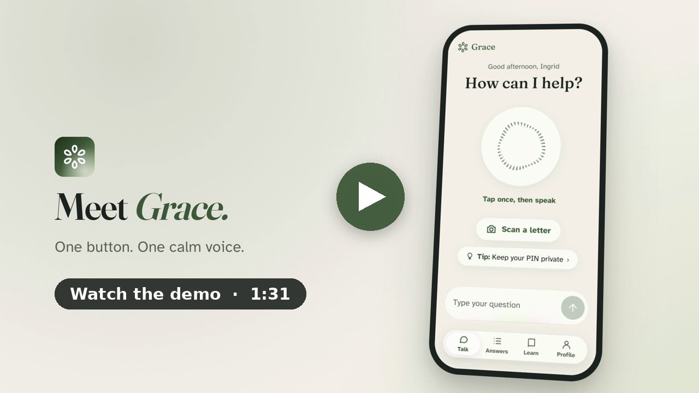
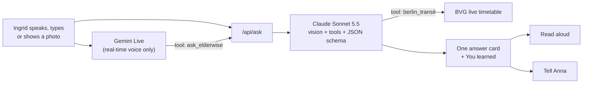

<p align="center">
  
</p>

<h1 align="center">Grace</h1>

<p align="center"><b>The AI companion that older adults simply talk to, and that teaches them AI while it helps.</b></p>

<p align="center">
  <a href="https://graceapp.vercel.app"><b>▶ Try the live app</b></a> ·
  <a href="https://github.com/BatuCani/grace/releases/download/demo-video-v1/grace-demo-16x9.mp4"><b>Watch the 91-second demo</b></a> ·
  Built in one day at Claude Impact Lab Berlin, 17 Oct 2026
</p>

<p align="center">
  
  
  
  
</p>

<p align="center">
  <a href="https://github.com/BatuCani/grace/releases/download/demo-video-v1/grace-demo-16x9.mp4">
    
  </a>
</p>

<p align="center">
  
  
  
  
</p>

## The problem
- **Who it's for:** older adults (65+), and the son or daughter who helps them.
- **Their problem with AI today:** every AI app assumes you can read dense screens, type well and know what to ask. So most older adults never try AI, while scammers already use it against them.
- **What Grace does:** you just say what you need, and show a letter or text message if you like. Grace answers with one big, calm card that is read aloud, and then tells you which AI skill you just used.

> In the EU, **fewer than 1 in 3 people aged 65–74** have basic digital skills ([Eurostat, 2023](https://ec.europa.eu/eurostat/web/products-eurostat-news/w/ddn-20240222-1)).
> In the US, people over 60 reported **$4.9 billion** lost to fraud in 2024, 43% more than in 2023 ([FBI IC3 via AARP](https://www.aarp.org/money/scams-fraud/fbi-report-fraud-2024.html)).

**Meet Ingrid, 78** (our fictional demo person). She gets a text: her parcel is held, pay a 1.99 EUR fee via a link. She taps one button and asks "Is this message real?". Grace shows a deep red scam alert with three plain reasons and reads it aloud. One tap sends a ready-written message to her daughter Anna. Then the "You learned" card says: *you can ask AI to check any message, letter or email.*

## Try it in 60 seconds
1. Open **https://graceapp.vercel.app** on your phone, or on a laptop in a narrow window. Tap **Skip** on the welcome screens.
2. On Talk, tap **+** → **Scan** → *Try with an example* → **Parcel text message**. Grace reads it and warns you that it is a scam.
3. Open **Answers**: tap **Tell my daughter Anna** to see the ready-written message, and scroll down to **You learned**.
4. Back on Talk, tap the big button and ask out loud, for example *"When does the next bus leave from Hermannplatz?"* (live Berlin timetable).
5. Open **Learn** for the 24 lessons and *My AI skills*. In **Profile**, set the text size to *Extra large* or switch to *Deutsch*.

## How Grace teaches AI
Older adults don't learn AI from tutorials. They learn it by solving a problem that matters to them today. Grace solves the problem first, then shows the person what they just did:

1. **Use it.** Ask out loud, or show a photo. No prompts, no menus.
2. **Name the skill.** Every answer ends with **"You learned"** (the AI skill just used) and a tip for the next skill to try.
3. **Collect skills.** **My AI skills** tracks 8 real skills, earned only by doing them: ask out loud, show a photo, check for scams, understand a letter, step by step, set a reminder, ask a follow-up, tell family.
4. **Practise and explore.** A 5-question **practice quiz** (also one tap from every scam alert) and **Learn**: 8 everyday topics with 24 short lessons, each one tried with Grace right away.

## Features
| | What it does |
|---|---|
| **Talk** | One big button: tap once, then speak. A real-time, hands-free conversation in a warm voice; your last words appear very big so you know Grace hears you. Typing, scanning and the tip of the day sit behind the **+**. |
| **Answers** | Every answer is one visual card: scam alert, explanation, steps, reminder (with *Add to calendar*), place or link. At most 3 points, read aloud, *Say it again, slower*. |
| **Scan a letter** | Photograph or upload a letter or bill, see the key facts copied exactly and a plain explanation. Also reads QR codes and GiroCode payment codes, with a scam check. |
| **Listen for me** | At the doctor's or a counter: live captions in very large text, then Claude sums up what was said and what to do next. Only text is kept, never sound. |
| **Family** | **Tell my daughter Anna** opens a ready-written message (SMS, WhatsApp/share or call). A family view shows the trusted person the week's questions and caught scams. |
| **Berlin buses and trains** | "When does my bus leave?" Claude checks live BVG departures and routes. |
| **Your way** | Text size up to Extra large without anything cut off, speaking speed, English or German, the assistant's name, voice and personality, a calm 9-step welcome. |
| **Accounts (optional)** | A free account (Supabase) brings answers and settings back on any phone. Without one, everything stays on the device. |

## Designed for people over 65
- **One screen, one job.** Four tabs, one big button, no chat history to scroll through.
- **See and hear.** Large text (at least 19 px, Atkinson Hyperlegible), tap targets of at least 48 px, every answer also read aloud.
- **Plain words.** Headlines of at most 6 words, one sentence, at most 3 points. No jargon, no "upload", no Markdown.
- **Calm, never shaming.** A scam alert says what to do, not what you did wrong.
- **The person decides.** Grace explains and suggests; contacting family is always one tap, never automatic.
- **Checked, not assumed:** a large-text and screen-reader review at iPhone SE and iPhone 14 size, in English and German, with every fix listed in [`docs/qa.md`](docs/qa.md).

## How Claude is used
**Claude is the brain: every answer, warning, explanation and lesson on screen comes from Claude.**



- **Vision:** `app/api/ask/route.ts` sends the spoken question and the photo of the letter, text message or medicine box to **Claude Sonnet 5.5** (Anthropic TypeScript SDK).
- **Structured output:** a JSON schema turns every reply into a card, not a wall of text: type, headline, sentence, points, steps, action, *You learned*, tip, and key facts from letters.
- **Tool use:** a `berlin_transit` tool lets Claude look up live BVG departures and journeys. It never invents lines or times.
- **Listen for me:** `app/api/listen/route.ts` turns a live transcript into one card (reminder, steps or explanation).
- **Voice:** Gemini Live only listens and speaks. For every real question it calls one tool, `ask_elderwise`, which asks Claude, and then reads Claude's answer aloud. Its key stays on the server (`app/api/live-token`). Without it, the button falls back to the browser's speech recognition.
- **Reliability:** a server-side fallback model is enabled, and every failure shows a friendly "please try again" message.
- **All prompts live in one place:** [`prompts/elderwise.ts`](prompts/elderwise.ts) (answers) and [`prompts/live.ts`](prompts/live.ts) (voice).

## Quality and safety
- **Tested answers:** 10 real situations (fake DHL text, "grandchild in trouble", bank PIN email, doctor's letter, pension change, medication box, appointment, higher electricity bill, "Microsoft virus" call, bigger phone text). **10 of 10 answers good** after prompt tuning, up from 5 of 10. Every case and every real answer is in [`docs/test-cases.md`](docs/test-cases.md).
- **Safety rules in the prompt:** numbers, amounts and doses are copied exactly and never invented. No medical, legal or financial advice: Grace explains, then names who to ask (doctor, pharmacist, the office, the trusted person). It never repeats a link from a suspicious message.
- **Privacy:** no API key reaches the browser. "Listen for me" keeps text, never audio. Without an account, answers stay on the phone. Accounts use row level security ([`supabase/migrations/`](supabase/migrations/)).
- **Demo data only:** Ingrid, Anna and every letter and message in [`public/samples/`](public/samples/) are fictional.

## Run it locally
```bash
git clone https://github.com/BatuCani/grace && cd grace
cp .env.example .env   # paste ANTHROPIC_API_KEY (required); GEMINI_API_KEY and NEXT_PUBLIC_SUPABASE_URL / NEXT_PUBLIC_SUPABASE_ANON_KEY are optional
npm install
npm run dev            # open http://localhost:3000
```
Without the optional keys, everything still works: the button uses browser speech, and answers stay on the device.
The microphone needs HTTPS or localhost; on plain http, typing works the same.

<details>
<summary><b>Project structure</b></summary>

| Folder | What's inside |
|---|---|
| `app/` | Screens (Talk, Answers, Learn, Profile, Scan, Listen, Practice, Family, Welcome) and API routes (`api/ask`, `api/listen`, `api/live-token`) |
| `components/` | Answer cards, voice orb, scan flow, Tell Anna sheet, navigation |
| `lib/` | Profile, answers, skills, speech, Gemini Live client, account sync |
| `prompts/` | Every prompt and the answer schema |
| `supabase/` | Database tables and row level security |
| `docs/` | Pitch, demo script, test cases, accessibility QA |
| `video/` | Source of the demo video (HyperFrames) |

**Stack:** Next.js 16 (App Router, TypeScript), Tailwind CSS 4, Anthropic API, Gemini Live API, Supabase, browser Web Speech API, deployed on Vercel.
</details>

## What's next
- **Family code word:** Grace helps the family agree on a secret word, so Ingrid can tell a fake "grandchild" call or AI voice clone from the real one.
- **Test with real older adults** at senior centres in Berlin, and add more languages (Turkish, Arabic, Russian).
- **Who pays:** families (keep parents independent and safe), banks and insurers (fewer scam losses), cities (digital inclusion). These are hypotheses to test, not customers yet.

## Team
| Name | Role |
|---|---|
| Batu | Builder: voice flow, Claude API route, design, layout |
| Sam | Claude prompts and answer quality, Talk screen, practice quiz |
| MaRie | Answer cards, answer history, pitch deck |
| Ahmet | Demo photos, the "Add a photo" flow and photo questions |
| Endrik | Tell Anna, Profile, accessibility and large-text QA, README |

More: [pitch](docs/PITCH.md) · [5-minute presentation](docs/PRESENTATION.md) · [demo script](docs/demo-script.md) · [video script](video/script.md)

## Credits
- [Next.js](https://nextjs.org), [React](https://react.dev), [Tailwind CSS](https://tailwindcss.com) (MIT).
- [Anthropic TypeScript SDK](https://github.com/anthropics/anthropic-sdk-typescript) (MIT) and the Claude API.
- [Google Gen AI SDK](https://github.com/googleapis/js-genai) (Apache-2.0) and the Gemini Live API for the real-time voice.
- From [libraries.dev](https://libraries.dev): [voice-glow](https://www.npmjs.com/package/voice-glow), [thinking-orbs](https://www.npmjs.com/package/thinking-orbs), [liquid-gooey](https://www.npmjs.com/package/liquid-gooey) and [bot-avatars](https://www.npmjs.com/package/bot-avatars) (MIT).
- [Supabase](https://supabase.com) (`@supabase/ssr`, `@supabase/supabase-js`, MIT) for accounts.
- [zxing-wasm](https://github.com/Sec-ant/zxing-wasm) (MIT) for QR codes and barcodes.
- [BVG REST API](https://v6.bvg.transport.rest) (free, no key) for Berlin departures.
- Fonts: [Atkinson Hyperlegible](https://fonts.google.com/specimen/Atkinson+Hyperlegible), [Fraunces](https://fonts.google.com/specimen/Fraunces) and [Instrument Serif](https://fonts.google.com/specimen/Instrument+Serif) (OFL), via Google Fonts. The pitch deck serves its own copies from `public/pitch/fonts/` so it works offline.
- [Orbs / micro-intent](https://github.com/Orb-agent/micro-intent), our team's earlier hackathon project: the audio capture, barge-in and reconnect patterns and the voice rules for older adults are adapted from it.
- Demo video: [HyperFrames](https://github.com/heygen-com/hyperframes) and [GSAP](https://gsap.com), voiceover by [ElevenLabs](https://elevenlabs.io), music synthesized in `video/tools/make_audio.py`.
- "Scan a letter" is inspired by the Dribbble shot [Onboarding flow (Upload your bill)](https://dribbble.com/shots/27784869) by Eugen Esanu (patterns only, no assets copied).
