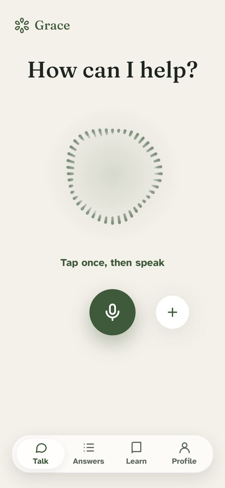
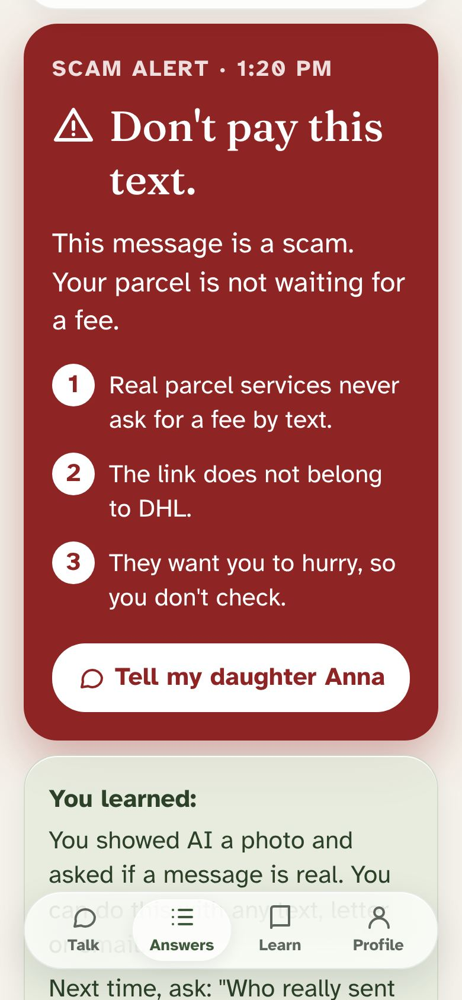
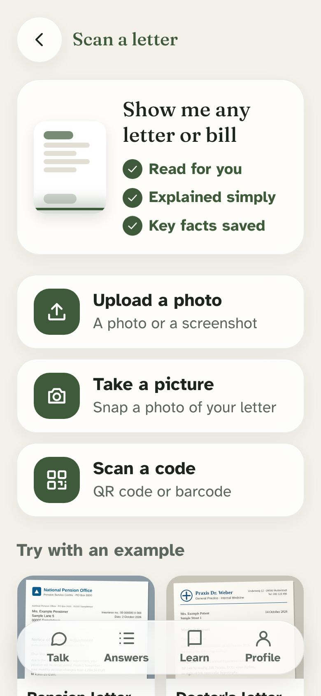
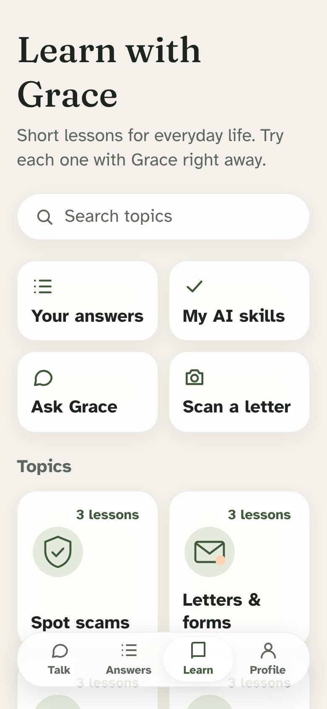

<p align="center">
  
</p>

<h1 align="center">Grace</h1>

<p align="center"><b>A patient voice AI companion that helps older adults use AI, and learn it while they do.</b></p>

<p align="center">
  <a href="https://graceapp.vercel.app"><b>Live app</b></a> ·
  <a href="https://github.com/BatuCani/grace/releases/tag/demo-video-v1"><b>Demo video</b></a> ·
  Built at Claude Impact Lab Berlin, 17 October 2026
</p>

<p align="center">
  
  
  
  
</p>

## Why Grace
- **Who it's for:** older adults (65+), and the son or daughter who helps them.
- **The problem:** AI apps assume you can read dense screens, type well and know what to ask, so most older adults never try AI, while scammers already use it against them.
- **What Grace does:** you just say what you need (and show a letter or text message if you like); Grace answers with one big, calm card that is read aloud, and tells you which AI skill you just used.

Our demo person is Ingrid, 78 (fictional). She gets a text: her parcel is held, pay a small fee via a link. She taps one button and asks "Is this message real?". Grace shows a deep red scam alert with three plain reasons, reads it aloud, and one tap tells her daughter Anna. The "You learned" card says: you can ask AI to check any message, letter or email.

## Features
| | What it does |
|---|---|
| **Talk** | One big button: tap once, then speak. A real-time, hands-free conversation; your last words appear very big so you know Grace hears you. Typing and photos sit behind the "+". |
| **Answers** | Every answer is one visual card (scam alert, explanation, steps, reminder with "Add to calendar", place or link), max 3 points, read aloud, "Say it again, slower". Ends with **"You learned"**. |
| **Scan a letter** | Photograph or upload a letter or bill, see the key facts and a plain explanation. Also reads QR codes and GiroCode payment codes, with a scam check. |
| **Listen for me** | At the doctor's or a counter: live captions in very large text, then Claude sums up what was said and what to do next. Only text is kept, never sound. |
| **Learn** | 8 everyday topics with 24 short lessons you try with Grace right away, a 5-question practice quiz, and "My AI skills" that grow with every real use. |
| **Family** | **"Tell my daughter Anna"** opens a ready-written message (SMS, WhatsApp/share or call). A family view shows the trusted person what was asked and which scams were caught. |
| **Made for older eyes and ears** | Text size up to Extra large without anything cut off, speaking speed, English or German, assistant name, voice and personality, a calm 9-step welcome. |
| **Berlin buses and trains** | "When does my bus leave?" Claude checks live BVG departures and routes. |
| **Accounts (optional)** | Free account (Supabase) so answers and settings come back on any phone. Without one, everything stays on the device. |

## How Claude is used
**Claude is the brain. Every answer, warning, explanation and lesson on screen comes from Claude.**

- `app/api/ask/route.ts` sends the spoken question and the photo (vision) to **Claude Sonnet 5.5** with the Anthropic TypeScript SDK.
- **Structured output** (JSON schema) turns every reply into a card instead of a wall of text: type, headline of at most 6 words, one sentence, up to 3 points, steps, an action, and the "You learned" text.
- **Tool use:** a `berlin_transit` tool lets Claude look up live BVG departures and journeys.
- `app/api/listen/route.ts` turns a "Listen for me" transcript into one card (reminder, steps or explanation).
- All prompts live in `prompts/` (`elderwise.ts` for answers, `live.ts` for the voice). A server-side fallback model is enabled, and errors show a friendly message.
- **Gemini Live is only the voice.** It listens and speaks in real time, but for every real question it calls one tool, `ask_elderwise`, which asks Claude. Gemini then reads Claude's answer aloud. The Gemini key stays on the server (`app/api/live-token`). Without it, the button falls back to push-to-talk with the browser's speech recognition.

```
Voice (Gemini Live) or typing ─▶ /api/ask ─▶ Claude Sonnet 5.5 (vision + tools + JSON schema) ─▶ answer card ─▶ read aloud + "You learned"
```

## Run it locally
```bash
git clone https://github.com/BatuCani/grace && cd grace
cp .env.example .env   # paste ANTHROPIC_API_KEY (required); GEMINI_API_KEY and NEXT_PUBLIC_SUPABASE_URL / NEXT_PUBLIC_SUPABASE_ANON_KEY are optional
npm install
npm run dev            # open http://localhost:3000
```
Best in a phone-sized window, or on a phone (Safari: Share → Add to Home Screen).
The microphone needs HTTPS or localhost; on plain http the typing field works the same.
Accounts need the table and security rules in `supabase/migrations/`.

**Stack:** Next.js (App Router, TypeScript), Tailwind CSS, Anthropic API, Gemini Live API, Supabase, browser Web Speech API. Deployed on Vercel.

## Demo video
- Release page: https://github.com/BatuCani/grace/releases/tag/demo-video-v1
- Direct file (16:9): https://github.com/BatuCani/grace/releases/download/demo-video-v1/grace-demo-16x9.mp4
- Made from real screens of the app with HyperFrames; script and sources in [`video/`](video/script.md).

## Team
| Name | Role |
|---|---|
| Batu | Builder: voice flow, Claude API route, design, layout |
| Sam | Claude prompts and answer quality, Talk screen, practice quiz |
| MaRie | Answer cards, answer history, pitch deck |
| Ahmet | Demo photos, the "Add a photo" flow and photo questions |
| Endrik | Tell Anna, Profile, accessibility and large-text QA, README |

More: [pitch](docs/PITCH.md) · [5-minute presentation](docs/PRESENTATION.md) · [demo script](docs/demo-script.md) · [accessibility QA](docs/qa.md) · [answer test cases](docs/test-cases.md)

## Credits
- [Next.js](https://nextjs.org), [React](https://react.dev), [Tailwind CSS](https://tailwindcss.com) (MIT).
- [Anthropic TypeScript SDK](https://github.com/anthropics/anthropic-sdk-typescript) (MIT) and the Claude API.
- [Google Gen AI SDK](https://github.com/googleapis/js-genai) (Apache-2.0) and the Gemini Live API for the real-time voice.
- From [libraries.dev](https://libraries.dev): [voice-glow](https://www.npmjs.com/package/voice-glow), [thinking-orbs](https://www.npmjs.com/package/thinking-orbs), [liquid-gooey](https://www.npmjs.com/package/liquid-gooey) and [bot-avatars](https://www.npmjs.com/package/bot-avatars) (MIT).
- [Supabase](https://supabase.com) (`@supabase/ssr`, `@supabase/supabase-js`, MIT) for accounts.
- [zxing-wasm](https://github.com/Sec-ant/zxing-wasm) (MIT) for QR codes and barcodes.
- [BVG REST API](https://v6.bvg.transport.rest) (free, no key) for Berlin departures.
- Fonts: [Atkinson Hyperlegible](https://fonts.google.com/specimen/Atkinson+Hyperlegible) and [Fraunces](https://fonts.google.com/specimen/Fraunces) (OFL), via Google Fonts.
- [Orbs / micro-intent](https://github.com/Orb-agent/micro-intent), our team's earlier hackathon project: the audio capture, barge-in and reconnect patterns and the voice rules for older adults are adapted from it.
- Demo video: [HyperFrames](https://github.com/heygen-com/hyperframes) and [GSAP](https://gsap.com), voiceover by [ElevenLabs](https://elevenlabs.io), music synthesized in `video/tools/make_audio.py`.
- "Scan a letter" is inspired by the Dribbble shot [Onboarding flow (Upload your bill)](https://dribbble.com/shots/27784869) by Eugen Esanu (patterns only, no assets copied).
- All people, letters and messages in the demo (Ingrid, Anna, `public/samples/`) are fictional. No real personal data.
