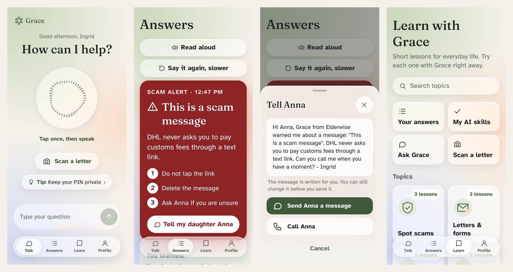

#  Grace

**Try it:** https://elderwise-beryl.vercel.app (best on a phone; tap Share → Add to Home Screen on iPhone)



**One line:** a patient voice AI companion for older adults: say what you need (and show a photo if you like), and get a simple visual answer that is read aloud, plus one AI skill learned each time.

- **Audience:** older adults (65+) and the family members who help them.
- **Their problem with AI today:** apps and chatbots assume you can read dense screens and type well, so most older adults never try AI, and scammers exploit the gap.
- **What the demo lets them do:** press one button, ask out loud about a letter, text message or appointment, and get a big, calm answer card with a "You learned" tip.

## What it does
A 9-step welcome (calm, skippable screens: who you are, your name, help topics, how Grace explains, tip rhythm, text size and voice, trusted person, optional free account, summary), then four tabs and one guided flow, nothing more:
- **Talk:** "How can I help?" and one big talking orb: "Tap once, then speak" (holding it works too). Grace, the assistant, has a natural hands-free conversation, and while you speak the **last 3 words you said appear very big**, so you can see that Grace really hears you. Below the orb sits an AI tip of the day. Prefer typing? Use the bar above the tab bar. The camera opens an "Add a photo" sheet: take a photo, or pick one of 5 example photos (parcel scam SMS, "Hi Grandma" WhatsApp scam, doctor's letter, medicine box, pension letter).
- **Scan a letter:** a guided flow from the Talk screen (the "Scan a letter" button, or the camera sheet). Photograph or upload a letter or bill, or try an example, then watch it being read and see the key facts and a plain explanation. It also scans QR codes and barcodes, including GiroCode payments, with a scam check.
- **Answers:** the newest answer as one big visual card: a deep red scam alert, an explanation, steps or a reminder, with up to 3 numbered points. On a scam alert, **"Tell my daughter Anna"** opens a ready-written message to the trusted person (SMS, WhatsApp/share or a call), so the family knows in one tap. Every answer is read aloud and ends with a "You learned" card that names the AI skill just used. Older answers are listed below and open full screen; "Clear history" at the bottom.
- **Learn:** "Learn with Grace", 8 everyday topics (like spotting scams, letters and forms) with 24 short lessons you can try with Grace right away, plus "My AI skills".
- **Profile:** text size (the whole app grows, nothing gets cut off), speaking speed, language (English or German), the assistant's name, voice and personality, the trusted person (editable) and your account.

**Accounts (optional):** create a free account with email and password (`/signup`, `/signin`) and your answers and settings are saved in it, so they come back after signing in on any phone.
"Continue without account" is always there; without an account everything stays in the browser.
Accounts use Supabase Auth; the tables and row level security rules are in `supabase/migrations/`, the sync code in `lib/sync.ts`.
The demo uses fake data (Ingrid and her daughter Anna).

## How Claude is used
`app/api/ask/route.ts` sends the photo (as an image block) and the spoken question to `claude-sonnet-5-5` with the official Anthropic TypeScript SDK.
The system prompt in `prompts/elderwise.ts` asks for plain language, scam warnings, and numbers copied exactly from the photo.
Structured output (`output_config.format`, JSON schema) returns the card type, a headline of at most 6 words, one sentence, up to 3 points, an optional action, and the "You learned" text.
Server-side refusal fallback (`fallbacks: "default"`) is enabled so a declined request is retried on a fallback model.

Hands-free voice: tapping the mic opens a real-time conversation with the Gemini Live API, which listens and speaks in a warm voice.
Gemini is only the voice. Every real question goes to Claude through one tool, `ask_elderwise` (`prompts/live.ts`), which calls `/api/ask`, saves the card to Answers, and hands Claude's headline and sentence back for Gemini to say.
`app/api/live-token/route.ts` creates a short-lived, single-use Gemini token on the server, so `GEMINI_API_KEY` never reaches the browser.
If Live is not available, the mic falls back to push-to-talk with the browser's speech recognition.
The voice uses `gemini-3.8-live`, with `gemini-3.1-flash-live-preview` as automatic fallback. Dropped connections resume the same conversation, and talking over the answer stops it at once.
During a conversation, the camera button shares the back camera live: one JPEG frame per second goes into the Live session, so Gemini sees what the person points at, and Claude gets the latest frame as the photo for the answer card.

## How to run it
```bash
cp .env.example .env    # paste your ANTHROPIC_API_KEY (and optionally GEMINI_API_KEY, and the Supabase URL and anon key) into .env
npm install
npm run dev             # open http://localhost:3000
```
On a phone in the same Wi-Fi, open `http://<your-laptop-ip>:3000`.
Voice input uses the browser Web Speech API (Chrome, Safari on iPhone). The microphone needs HTTPS or localhost, so on a phone over plain http the typed field is the fallback.

**Live link:** https://elderwise-beryl.vercel.app

## Demo video
<Add the link to the 2-minute demo video here.>

## Team
| Name | Role in this project |
|---|---|
| Batu | Builder: voice flow, Claude API route, Liquid Glass design, layout |
| Sam | Claude prompts and answer quality, Talk screen |
| Ahmet | Demo photos and the "Add a photo" flow |
| MaRie | Answer cards, answer history, pitch deck |
| Endrik | Profile tab, accessibility and large-text QA |

## Credits
- [Next.js](https://nextjs.org) (MIT), [React](https://react.dev) (MIT), [Tailwind CSS](https://tailwindcss.com) (MIT).
- [Anthropic TypeScript SDK](https://github.com/anthropics/anthropic-sdk-typescript) (MIT) and the Claude API.
- [Google Gen AI SDK](https://github.com/googleapis/js-genai) (Apache-2.0) and the Gemini Live API for the real-time voice.
- [Orbs / micro-intent](https://github.com/Orb-agent/micro-intent), our team's earlier hackathon project: the PCM capture worklet, the barge-in and reconnect patterns, and the voice rules for older adults are adapted from it.
- [voice-glow](https://www.npmjs.com/package/voice-glow) (MIT) for the voice-reactive glow around the input.
- [Supabase](https://supabase.com) (`@supabase/ssr`, `@supabase/supabase-js`, MIT) for accounts and saving answers.
- [Atkinson Hyperlegible](https://fonts.google.com/specimen/Atkinson+Hyperlegible) (OFL) and [Fraunces](https://fonts.google.com/specimen/Fraunces) (OFL) via Google Fonts.
- [zxing-wasm](https://github.com/Sec-ant/zxing-wasm) (MIT) reads QR codes and barcodes in "Scan a letter" when the browser has no built-in BarcodeDetector.
- Browser Web Speech API (SpeechRecognition and speechSynthesis).
- Sample images in `public/samples/` are fictional mocks made for this demo; no real personal data.
- The "Scan a letter" flow is inspired by the Dribbble shot [Onboarding flow (Upload your bill)](https://dribbble.com/shots/27784869) by Eugen Esanu (patterns only, no assets copied).
